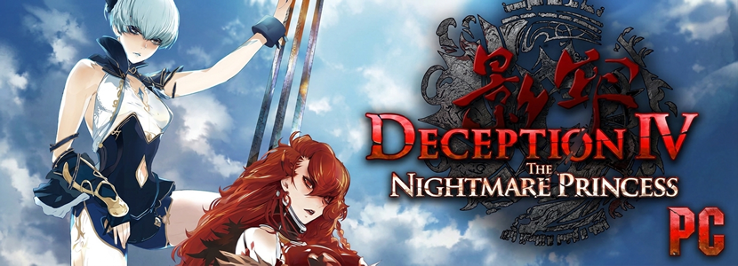

# Deception IV: The Nightmare Princess (PS4) - Recompiled to PC

An (obviously) unofficial port of the PS4 version of <b>Deception IV: The Nightmare Princess</b>, KOEI TECMO's trap-laying action game, to Windows and Linux.

The game's own x86-64 code runs directly on the PC: the PS4 system libraries it calls are reimplemented, and its GPU commands are drawn with Vulkan.

🚨 **No game files are included** 🚨

This requires you to provide a decrypted dump of your own copy of the game. Only tested with **CUSA02859** with **update 1.01**, may work with other versions but not guaranteed.

## Features

- **Any window size:** windowed, borderless or fullscreen, at 720p, 900p, 1080p, 1440p, 4K and more. The game renders at its native 1080p and is scaled to the window, with AMD FSR 1 RCAS sharpening.
- **Native 30 FPS** at the right game speed (see [Frame rate](#frame-rate)).
- **Update and DLC support** from your own dumps.
- **Built in skip intro:** (optionally) boots straight to the title menu (NEW GAME / CONTINUE) in about 6 s: the logos, the autosave notice and "Press ANY button" are skipped.
- **Display settings in the game:** press **F10**, or hold **Select** (View, Back, Share) for two
  seconds, for window mode, resolution, VSync and more.
- **Keyboard and any gamepad.** DualShock 4 and DualSense work as they are, Xbox-style pads by
  button position.
- **Easy setup:** point the installer at your dump, and it can add a desktop shortcut (on Linux, an application menu entry).
- **Portable:** saves, settings and shader caches stay in the game's folder (nothing in `%APPDATA%`).

## Why not just use shadPS4?

shadPS4 is a general PS4 emulator, and this project builds on its video core. It is made for this one game, so it can do things a general emulator does not:

- **Sound and music.** The game's sound engine (KOEI TECMO's KTSL2 mixer and its streamed ATRAC9 music) is implemented in full, so sound effects and music play.
- **Intro skip.** A start lands on the title menu in about 6 s, past the logos, the autosave notice and "Press ANY button".
- **One-step setup.** Point the setup at your dump (and optionally its update and DLC): it prepares the game, adds a shortcut or menu entry, and that's it. No emulator settings or game list to manage.
- **Portable.** Saves, settings, logs and shader caches stay in the game's folders; nothing goes to `%APPDATA%`.
- **In-game display settings** (F10, or hold Select): window mode, window size, monitor, VSync and sharpening, changed while you play, on a page styled like the game's own menus.
- **Only options that work for this game.** No frame rate unlock that would speed the game up, no 4K or HDR switches it cannot use.
- **Help when it breaks.** A crash keeps its log and says where it is; a freeze writes what every thread was doing.

What it does not change: the game still runs at its native 30 FPS and renders at 1080p in 16:9, as it does on PS4 and on shadPS4.

## Requirements

- **Windows:** Windows 10 or 11, 64-bit. Python and everything else comes with the release.
- **Linux:** x86-64 with glibc 2.39 or newer (SteamOS 3.7, Ubuntu 24.04, Debian 13, Fedora 40 or
  newer, Arch) and Python 3.10 or newer (`python3`) for the setup.
- A CPU with AVX.
- A GPU with Vulkan 1.3 and a current driver (on Linux, Mesa or the NVIDIA driver).
- A decrypted dump of your own copy of the game: the folder with `eboot.bin`, `sce_module`,
  `sce_sys` and `FILE_PS4`. Its update (patch) dump is optional but recommended.

## Install and play

1. [Download the latest release here](https://github.com/rcostanza/deception-recomp/releases/latest)
2. Unzip the release anywhere, for example `C:\Games\Deception`.
3. Run `deception-setup.exe`.
4. Choose your **game folder** (the dump), optionally an **update folder** (found by itself when it sits next to the game as `<game>-patch`, as shadPS4 keeps it) and a **DLC folder**, and a **save folder** (by default `save` inside the release folder). Each row says whether the folder is usable, and **Install** turns on once the game folder holds your dump. Press it: setup prepares the game from your dump in a few seconds and offers a desktop shortcut. Your dumps are only read, never changed.
5. Press **Play Game**. Later, start `deception.exe` or the shortcut.

Run `deception-setup.exe` again any time to change folders; it offers to copy your saves when the save folder moves. Untick **Skip the intro** there (or set `skip_intro=0` in `settings.ini`) to see the logos and the title screen again.

The setup also works from the command line:

```
deception-setup.exe --game <dump> [--update <folder>|--no-update] [--dlc <folder>|--no-dlc]
                    [--save <folder>] [--skip-intro|--play-intro] [--shortcut desktop]
```

### On Linux

1. Extract the release anywhere you can write: `tar -xzf deception-pc-<version>-linux.tar.gz -C ~/Games`
2. Run `deception-setup`: from a file manager it asks with dialogs, in a terminal it asks there. It also
   takes the same arguments as on Windows (`--game <dump> [--update <folder>] [--save <folder>] [--dlc <folder>]`).
3. Start the game from the menu entry it adds, or run `./deception`.

On a Steam Deck, do this in Desktop Mode; _Add a Non-Steam Game_ in Steam then lists the menu entry.

### Updating

Unzip the new release over the old folder and run the setup once more (the game asks you to). Your folders, saves and settings are kept.

### DLC

A DLC dump is a folder per add-on, named after its label (the end of its content ID), each with its `sce_sys` and `dlc` folders. shadPS4's `dlc/CUSA02859` folder works as it is:

```
<folder containing your DLCs>/
  DLC0000000000001/
    dlc/
    sce_sys/
  ...
```

## Settings

`settings.ini` in your save folder holds every setting, each with a comment. The **Display Settings** panel (**F10**, or hold **Select** for two seconds) changes most of them while the game runs and saves them when it closes:

- window mode, windowed resolution (16:9 sizes, like the game; applied a second after you stop changing
  it) and monitor. The fullscreen modes pick their size from the screen, with black bars when the
  screen is not 16:9;
- VSync, and tearing with VSync off (the least input delay);
- sharpening (AMD FSR 1 RCAS, on by default), applied at once; **F9** also switches it over the game, to compare.

### Frame rate

The game runs at 30 FPS, as on PS4. Its logic advances one step per frame, so it cannot be unlocked: the engine has a dormant 60 FPS mode, but with it everything moves at double speed. No other cap is offered for the same reason.

## Controls

The game sees one DualShock 4. Any gamepad works, mapped by button position: on an Xbox pad A B X Y
are Cross, Circle, Square, Triangle, LB/RB are L1/R1, LT/RT are L2/R2, Menu is Options and View
clicks the touchpad. The keyboard works alongside a gamepad:

| Keys                      | PS4                      |
| ------------------------- | ------------------------ |
| W A S D / I J K L         | left stick / right stick |
| arrow keys                | d-pad                    |
| Space, Enter              | Cross                    |
| Escape, Backspace, `;`    | Circle                   |
| F / H                     | Square / Triangle        |
| Q, Page Up / O, Page Down | L1 / R1                  |
| E / U                     | L2 / R2                  |
| X / M                     | L3 / R3                  |
| Tab, P                    | Options                  |
| T                         | touchpad click           |

| Shortcut                        | What it does                                  |
| ------------------------------- | --------------------------------------------- |
| **F10**, or hold **Select** 2 s | Display Settings                              |
| **F9**                          | sharpening on or off                          |
| **F4**                          | asks "Exit Deception?" (No is selected first) |
| **Alt+F4**                      | closes the game without confirmation          |

## When something goes wrong

The game logs to `deception.log` in the `log` folder of your save folder. If it closes by itself, it
says so and keeps that log as `crash-<date>-<time>.log` in the same folder; attach that file when
you report the problem. If the picture freezes, leave the game running for half a minute before
closing it: after 20 seconds without a new frame it writes what every thread is doing to the log.

## Building from source

[docs/building.md](docs/building.md) covers the toolchain, building, tests and packaging, and
[docs/development.md](docs/development.md) how the runner works and how to work on it.

## 🤖 AI usage disclaimer 🤖

**_This project was thoroughly made by AI._**

I (human) am a programmer, but I know nothing about C++ which is required to make this possible. And so, I've done precisely three things in this project:

1. Paid for AI
2. Told AI what to do
3. Tested out whatever AI did

## Credits and license

Based on and inspired by [theatrhythm-fbl-pc](https://github.com/YAPhoa/theatrhythm-fbl-pc).

GPL-2.0-or-later, see [LICENSE](LICENSE). The overlay uses the fonts DejaVu Sans (Bitstream Vera license), Cinzel and Josefin Slab (SIL Open Font License 1.1); their licenses are in `gpu/third_party/fonts`. Runtime follows [shadPS4](https://github.com/shadps4-emu/shadPS4). Deception IV: The Nightmare Princess is a game by KOEI TECMO GAMES; this project is not affiliated with or endorsed by them.
